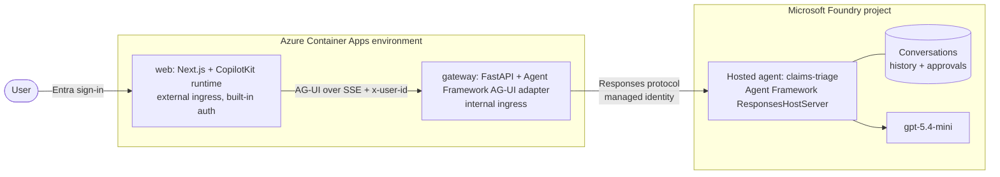

# AG-UI web client for a Foundry Hosted Agent

This template connects a browser chat app to a Microsoft Foundry Hosted Agent
over the [AG-UI protocol](https://docs.ag-ui.com). The web app uses
[CopilotKit](https://docs.copilotkit.ai). A small gateway uses Microsoft Agent
Framework's AG-UI adapter to translate between AG-UI and the agent's Responses
protocol. The sample agent triages synthetic insurance claims. It can look
claims up freely, but escalating a claim needs a human to approve it in the chat.

It provides:

- **Streaming chat in the browser:** text, tool calls, and tool results stream
  to a CopilotKit chat as AG-UI events.
- **Human approval of agent actions:** an approval-gated tool pauses the hosted
  agent. The user approves or rejects it in an inline card, and the decision
  goes back to the hosted agent.
- **No client-side state store:** each chat thread is a Foundry conversation, so
  Foundry keeps history and pending approvals.
- **Per-user threads:** users sign in with Microsoft Entra ID, and the gateway
  rejects a thread that another user created.
- **No secrets:** managed identities reach Foundry and the container registry.
  Sign-in uses the web app's managed identity as a federated credential.

## What this template is for

- Learn how a browser app talks to a Foundry Hosted Agent through AG-UI.
- Deploy a working web client, gateway, and hosted agent with one `azd up`.
- Add human-in-the-loop approval to agent tools.
- Provide a starting point for a web front end to your own hosted agent.

## What this template is not for

This template is not a production-ready or multitenant application. It does not
deploy private networking (see
[Private-network Hosted Agent](../private-network-hosted-agent/)), route traffic
through API Management (see [APIM-hosted Foundry Agent](../apim-hosted-agent/)),
or add Teams, Microsoft 365, or mobile clients. It does not list a user's
earlier conversations or show their transcripts again after a page reload. It
does not keep pending approvals if the gateway restarts. The sample's claim
data, including escalations, lives in the hosted agent's memory: it is shared
by every conversation the agent container serves and resets when the
container restarts. It provides no
centralized monitoring, backup, disaster recovery, or support SLA.

Review [Cost planning](docs/cost.md) before provisioning.

## Architecture



| Component | Folder | What it does |
|---|---|---|
| Hosted agent | `src/agent` | An Agent Framework agent with `lookup_claim`, `list_flagged_claims`, and the approval-gated `escalate_claim`. Foundry builds it from source. |
| Gateway | `src/gateway` | About 120 lines, a third of it a temporary interop fix. Exposes the hosted agent as an AG-UI endpoint, creates Foundry conversations tagged with their owner, and enforces ownership. |
| Web app | `src/web` | Next.js with CopilotKit. Starts a conversation, streams the chat, renders tool calls, and shows the approval card. |
| Infrastructure | `infra-foundry`, `infra` | The `microsoft.foundry` layer creates the Foundry account, project, and model. A Bicep layer adds Container Apps, a registry, managed identities, RBAC, and the Entra app registration. |

See [Architecture](docs/architecture.md) for the request flow and security model.

## Deploy

Required tools: Azure CLI, Azure Developer CLI (`azd`) 1.32 or later, and an
Azure subscription where you can deploy a model in Microsoft Foundry.

The deploying identity needs:

- **Owner**, or **Contributor** and **User Access Administrator**, on the
  subscription;
- permission to create Microsoft Entra app registrations (allowed for all users
  by default; otherwise ask for the **Application Developer** role);
- available quota: 10K TPM of `gpt-5.4-mini` GlobalStandard.

Install the azd extensions:

```powershell
azd extension install azure.ai.agents
azd extension install azure.ai.projects
```

Run every command from this folder:

```powershell
az login
azd auth login
azd env new <environment-name> --subscription <subscription-id> --location <region>
azd env set AZURE_AI_MODEL_DEPLOYMENT_NAME gpt-5.4-mini
azd up
```

Choose a region that supports
[Foundry Hosted Agents](https://learn.microsoft.com/azure/foundry/agents/concepts/hosted-agents#region-availability)
and the pinned model. `azd up` provisions the Foundry layer, then the app layer,
then deploys the hosted agent, the gateway, and the web app. Open the `WEB_URL`
it prints and sign in.

## Try it

1. Ask **"Which claims are flagged?"** The agent calls `list_flagged_claims` and
   the tool result appears in the chat.
2. Ask **"Escalate CLM-1002 for an invoice review."** An approval card appears.
   Nothing has run yet.
3. Select **Approve.** The hosted agent runs `escalate_claim` once and replies
   with an `SIU-` reference. Ask **"What is the status of CLM-1002?"** to see
   `escalated`.
4. Ask it to escalate another claim and select **Reject.** The tool does not
   run, and the agent says so.

## Run locally

Deploy once with `azd up`, because the gateway calls the deployed hosted agent.
Your `az login` identity then needs **Azure AI User** on the Foundry project.

```powershell
# Terminal 1: the gateway
cd src/gateway
pip install -r requirements.txt
$env:FOUNDRY_PROJECT_ENDPOINT = (azd env get-value FOUNDRY_PROJECT_ENDPOINT)
$env:FOUNDRY_AGENT_NAME = 'claims-triage'
uvicorn app:app --port 8000

# Terminal 2: the web app
cd src/web
npm ci
$env:AGUI_GATEWAY_URL = 'http://localhost:8000'
npm run dev
```

Open http://localhost:3000. In development the web app uses a fixed local user
instead of Entra sign-in. To change the agent itself, use `azd ai agent run`
and `azd ai agent invoke --local`, then `azd deploy claims-triage`.

## Customize

- **Tools:** edit `src/agent/main.py`. Give side-effecting tools
  `approval_mode="always_require"`.
- **Tool rendering:** `src/web/src/app/tools.tsx` renders every tool call.
  Add `useRenderTool` for a custom card per tool.
- **Your own agent:** keep the gateway and web app, replace `src/agent`, and
  change the agent name in `azure.yaml` and `infra/app.bicep`.

The [`foundry-hosted-agent-copilotkit`](https://awesome-copilot.github.com/skill/foundry-hosted-agent-copilotkit/)
skill guides a coding agent through these changes, including generative UI,
shared state, and debugging the event stream.

## Clean up

```powershell
azd down --purge
az ad app delete --id (azd env get-value WEB_APP_REGISTRATION_CLIENT_ID)
```

`azd down` does not delete the Entra app registration, so the second command
removes it.
